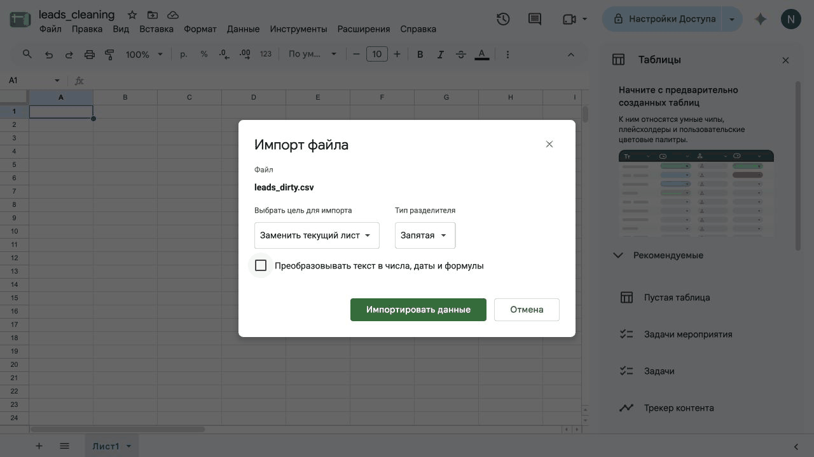
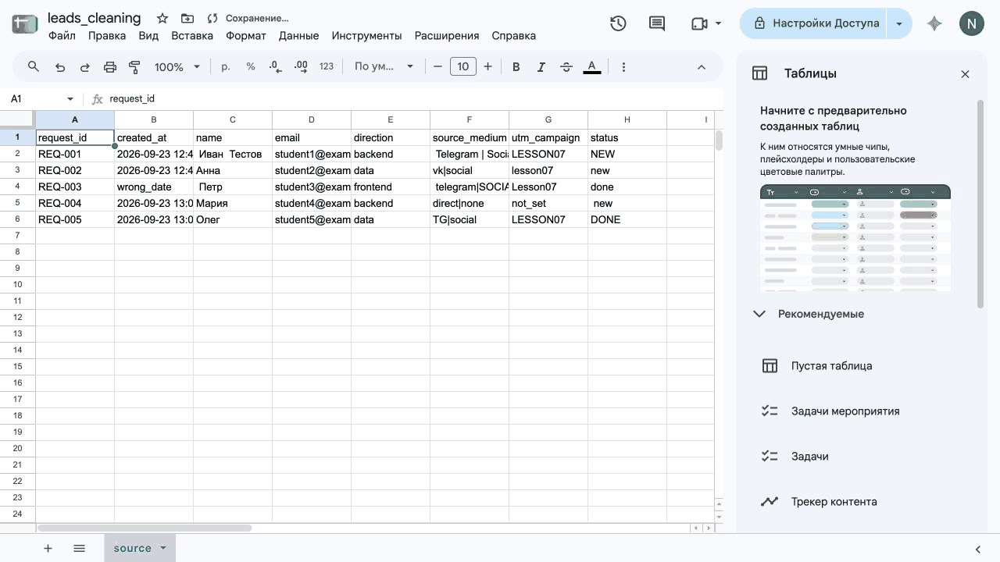
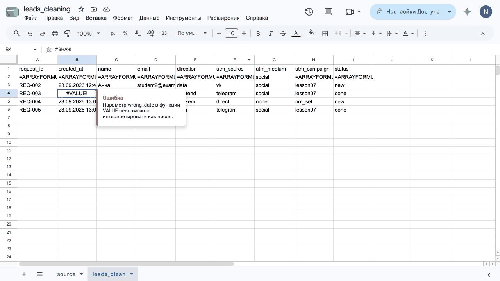
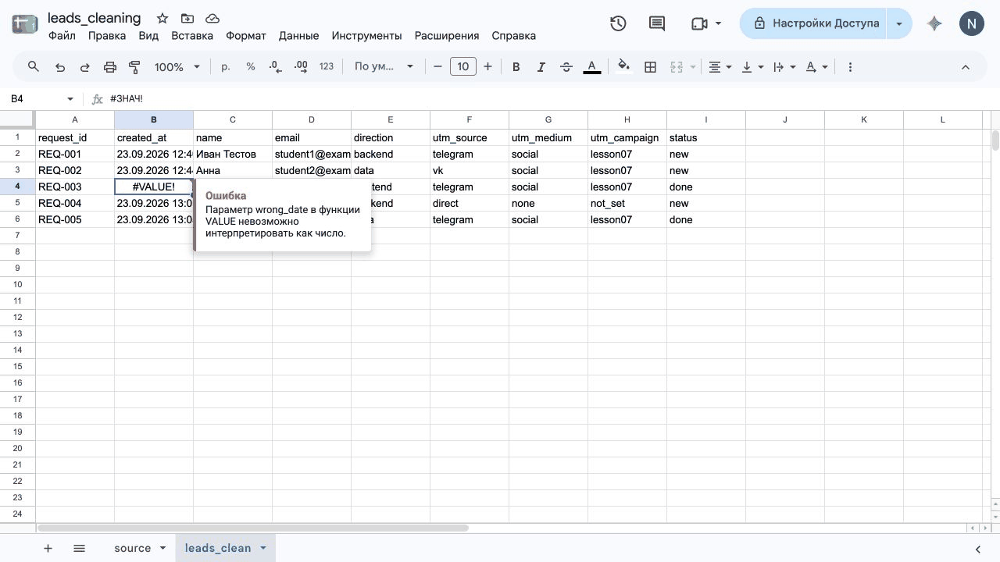
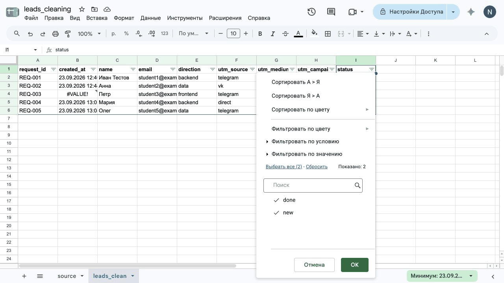
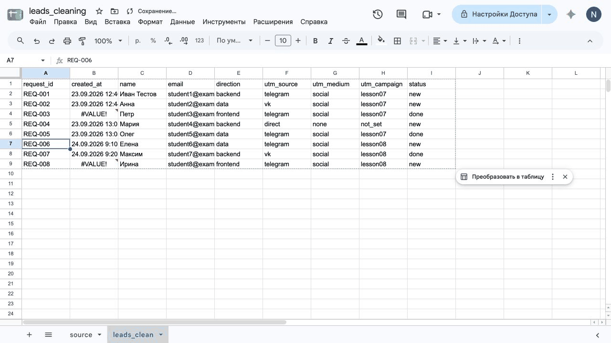
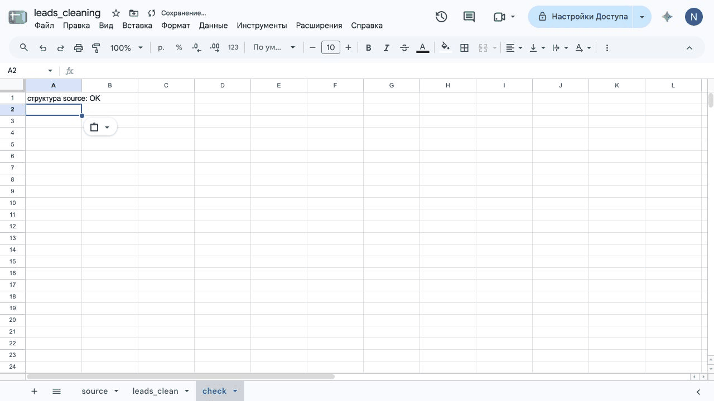

# Домашняя работа № 6 · Подготовка данных в Google Таблицах

**Дисциплина:** ОП.03 «Информационные технологии»

| Поле | Значение |
|---|---|
| Студент | Бугаев Тимофей |
| Группа | 9/2-РПО-25/2 |
| Номер работы | 6 |
| Тема работы | Повторяемая очистка выгрузки заявок в Google Таблицах |

## 1. Импорт

Создал [таблицу leads_cleaning](https://docs.google.com/spreadsheets/d/1uvYFJJXxyXDQPrckTQHO9735DWJUH_EH2IhR5I8oL-A/edit). Импортировал `leads_dirty.csv` на лист `source`: «Заменить текущий лист», разделитель «Запятая», автоматическое преобразование выключено.

## 2. Правила

Лист `leads_clean` содержит девять столбцов. Формулы ARRAYFORMULA стоят во второй строке. Формула F2 заполняет сразу источник и канал. Убрал лишние пробелы, привёл метки и статус к нижнему регистру и заменил `tg` на `telegram`.

## 3. Ошибка и проверка значений

Дата `wrong_date` у REQ-003 вызывает `#VALUE!`, ошибка оставлена видимой. В фильтре `status` два значения: `done` и `new`.

## 4. Вторая выгрузка

Импортировал `leads_dirty_v2.csv` на тот же лист. Формулы обработали восемь строк вместо пяти. У REQ-003 и REQ-008 видны ошибки дат. У REQ-006 получено «Елена / telegram / social / lesson08 / new», у REQ-007 — «Максим / vk / social / lesson08 / done».

[Скачанный CSV](leads_clean.csv)

## 5. Проверка структуры

Лист `check` сверяет восемь заголовков исходника. Результат: «структура source: OK».

ИИ: использовал для выполнения операций в таблице, проверки выгрузки и оформления отчёта.
